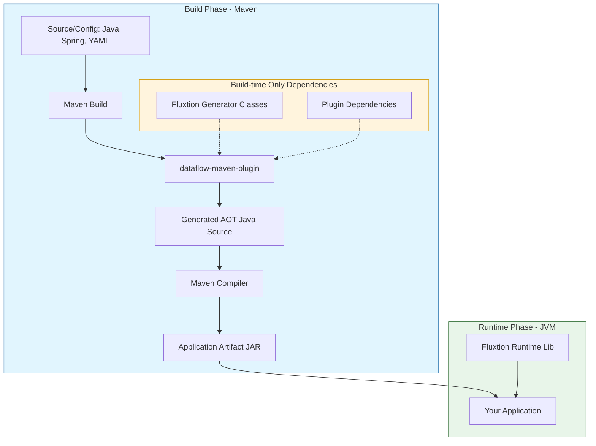

# dataflow-maven-plugin
A Maven plugin integrating the Fluxtion toolset with the Maven build cycle.

## Overview
Fluxtion is a high-performance, low-latency event processing engine. The `dataflow-maven-plugin` automates the generation of Fluxtion event processors from various sources (scanned classes, Spring contexts, or YAML configurations) during the Maven build lifecycle.

## Architecture and Execution Path

The following diagram illustrates how the `dataflow-maven-plugin` fits into the developer's execution path, highlighting the separation between build-time generation and runtime execution.



### Key Concepts

*   **Build-time Generation**: The `dataflow-maven-plugin` executes during the Maven `compile` phase. It processes your input configurations and generates optimized **Ahead-of-Time (AOT)** Java source code.
*   **AOT Source Usage**: The generated AOT source is automatically included in the compilation process. Your application code can then directly reference and use these generated classes for high-performance event processing.
*   **Separation of Concerns**: Fluxtion generator classes and plugin-specific dependencies are **only required during the build**. They do not need to be present on the runtime classpath, keeping your application artifact lean and minimizing runtime dependency conflicts.
*   **Runtime Requirements**: At runtime, your application only needs the core Fluxtion runtime library to execute the AOT-generated event processors.

## Repository Configuration
The plugin's dependencies are also in the same repository, you will need:

```xml
<repositories>
    <repository>
        <id>repsy-fluxtion</id>
        <name>Fluxtion public maven repo on Repsy</name>
        <url>https://repo.repsy.io/mvn/fluxtion/fluxtion-public</url>
    </repository>
</repositories>
```

## Usage

The plugin goals are bound to the `compile` phase by default. To trigger execution, you must define an `<execution>` block for the desired goal.

### Common Configuration
| Parameter | Description | Default |
|-----------|-------------|---------|
| `outputDirectory` | Path for generated Java sources. | `${project.build.sourceDirectory}` |
| `resourcesDirectory`| Path for generated resources. | `src/main/resources` |
| `-DskipFluxtion` | Command-line property to skip Fluxtion generation. | `false` |

### Goals

#### 1. `scan`
Scans compiled project classes for Fluxtion builder definitions and generates event processors.

```xml
<plugin>
    <groupId>com.telamin.fluxtion</groupId>
    <artifactId>fluxtion-maven-plugin</artifactId>
    <version>1.3.1</version>
    <executions>
        <execution>
            <goals>
                <goal>scan</goal>
            </goals>
            <configuration>
                <buildDirectory>target/classes</buildDirectory>
            </configuration>
        </execution>
    </executions>
</plugin>
```
*   `buildDirectory`: Directory to scan for classes (default: `target/classes`).

**Ensure mode** (requires `fluxtion-builder` 1.0.87 or later; an older builder is refused before generation).
With `ensureProcessor` set, the build reuses the committed processor when the compile request is unchanged, sending
nothing and needing no sign-in. When the request has changed it regenerates (signed in) and stamps the result, or, when
not signed in, fails with `FLX-1022` as the build's failure message.

| Parameter | Description | Default |
|-----------|-------------|---------|
| `ensureProcessor` (`-Dfluxtion.ensureProcessor`) | Reuse the committed processor when the request is unchanged. | `false` |
| `ensureSourceDirectory` | Where the committed processor source lives. | `${project.build.sourceDirectory}` |
| `ensureResourcesDirectory` | Where the committed request stamp (`<Processor>.fluxtion-request.json`) lives. | `${project.basedir}/src/main/resources` |
| `relocatableBase` | Optional package prefix the request digest ignores, so a repackaged processor still matches. | none |
| `-Dfluxtion.regenerate=true` | Regenerate even when the request is unchanged (also read from a profile property). | unset |

With `ensureProcessor` set, a project whose `fluxtion-builder` has no ensure support fails at once with a message
naming the version it needs, rather than regenerating on every build.

#### 2. `springToFluxtion`
Generates a Fluxtion event processor from a Spring context definition.

```xml
<plugin>
    <groupId>com.telamin.fluxtion</groupId>
    <artifactId>fluxtion-maven-plugin</artifactId>
    <version>1.3.1</version>
    <executions>
        <execution>
            <goals>
                <goal>springToFluxtion</goal>
            </goals>
            <configuration>
                <className>com.example.GeneratedProcessor</className>
                <packageName>com.example</packageName>
                <springFile>src/main/resources/spring.xml</springFile>
            </configuration>
        </execution>
    </executions>
</plugin>
```
*   `className`: (Required) Fully qualified name of the class to generate.
*   `packageName`: (Required) Package for the generated class.
*   `springFile`: (Required) Path to the Spring XML configuration.

#### 3. `yamlToFluxtion`
Generates event processors from YAML configuration files.

```xml
<plugin>
    <groupId>com.telamin.fluxtion</groupId>
    <artifactId>fluxtion-maven-plugin</artifactId>
    <version>1.3.1</version>
    <executions>
        <execution>
            <goals>
                <goal>yamlToFluxtion</goal>
            </goals>
            <configuration>
                <fluxtionConfigFiles>
                    <file>src/main/resources/config.yaml</file>
                </fluxtionConfigFiles>
            </configuration>
        </execution>
    </executions>
</plugin>
```
*   `fluxtionConfigFiles`: (Required) Array of YAML configuration files to process.

#### Upgrading generated processors from ≤1.0.86

Older generated processors have no request or promotion-ownership stamps. When moving such a project to an
ensure/promote build, promotion refuses to replace the existing files. If their Java copies carry the Fluxtion
generated header, the refusal lists the exact source and resource paths and explains the one-time recovery:

1. Keep a backup and review any local edits.
2. Move only the listed files outside the source/resource directories; keep authored nodes and other files.
3. Build again using the project's normal generation command and configured compiler route. Successful generation
   and promotion write the request and ownership stamps needed by subsequent builds.

The header is only a diagnostic hint. No files are adopted or overwritten automatically. A hand-written file,
missing recognizable header, or invalid existing stamp still gets the ordinary refusal: preserve the file and
resolve the conflict instead of assuming it is generated.

#### 4. `promote`
Promotes a scan written to a staging directory (`<outputDirectory>`/`<resourcesDirectory>` under `target/`) into the
project once the staged processor has compiled. Bind it at `process-classes`, after the scan and the compile of the
staging sources.

```xml
<execution>
    <id>promote-generated</id>
    <phase>process-classes</phase>
    <goals><goal>promote</goal></goals>
    <configuration>
        <generatedPackage>com.example.myapp.generated</generatedPackage>
    </configuration>
</execution>
```

*   The staged resources are always copied to `target/classes`, so the jar has this build's GraphML.
*   When the builder reused every staged processor (it writes `<Processor>.fluxtion-reused` beside each), `src/` is not
    touched.
*   Otherwise the generator's files are replaced one by one: each is written to a temporary file and renamed (a
    replaced file keeps its permissions, a new one gets the default ones), and unchanged files are not rewritten.
*   Only the generator's files are written or deleted: in the package's own directory, never a sub-package,
    `<Processor>.java` in the sources and `<Processor>.java`, `.graphml`, `.png` and `.fluxtion-request.json` in the
    resources, for a processor that is staged or has a committed stamp. Existing destinations require a valid
    committed request stamp identifying that processor (digest format 1 or 2), or an unchanged prior promotion
    ownership marker; an unstamped same-name user file
    refuses the entire promotion before any write. Move or rename conflicting user files, or restore their original
    stamp if they were generated. A stamped processor the scan no longer writes
    (a renamed one) has its files deleted; any other file in the package is left alone. PNG files are never promoted to
    `src/`, and the marker is never copied.
*   A symbolic link on the way to the generated package (below `sourceDirectory`/`resourcesDirectory`), or as one of a
    processor's files, fails the build before anything is written.
*   `generatedPackage` must be a Java package name. Staging that holds no processor in it fails the build and touches
    nothing. Resource destinations below `target/classes` receive the same link checks, including on reuse.
    `-DskipFluxtion` or `-Dfluxtion.promote.skip` skips the goal.
*   Staging must be emptied before every scan, for example with a `maven-clean-plugin` execution at `initialize`:
    Successful promotion writes `<Processor>.fluxtion-owned.json` beside the resources **after** the processor's
    files have been written. Keep this file with the generated sources: it records content hashes, including for
    custom-template output that has no reusable request stamp. A later user edit or interrupted promotion refuses
    automatic replacement; preserve the edits or restore the previous generated files before retrying. CRLF/LF
    conversion alone is accepted. Ownership does not certify that the processor can be reused; the builder's
    request stamp still controls that decision.

    `promote` promotes every processor it finds there, so a previous build's leftovers would be promoted with this
    one's. `promote` does not clear staging itself, because a failed scan or compile stops the build before it runs
    and would leave staging behind anyway; only a clear before the scan covers every case.

| Parameter | Description | Default |
|-----------|-------------|---------|
| `generatedPackage` (`-Dfluxtion.generatedPackage`) | The package the scan generates into; required. | none |
| `stagingSourceDirectory` | Staged sources. | `${project.build.directory}/fluxtion-staging/java` |
| `stagingResourcesDirectory` | Staged resources. | `${project.build.directory}/fluxtion-staging/resources` |
| `sourceDirectory` | Where sources are promoted. | `${project.build.sourceDirectory}` |
| `resourcesDirectory` | Where resources are promoted. | `${project.basedir}/src/main/resources` |
| `classesDirectory` | Where staged resources are copied for the jar. | `${project.build.outputDirectory}` |
| `deferToTests` (`-Dfluxtion.promote.deferToTests`) | When the build reaches `test`, leave `src/` to an `afterTests` execution (1.3.4). | `false` |
| `afterTests` | Set on a second execution bound to `test`: promote what `deferToTests` held back. | `false` |

Since 1.3.4:

*   **One transaction.** The `src/` files of a generation are prepared beside their destinations, a journal
    (`.fluxtion-promote.json` in the resources package) is the commit point, then the files are renamed into place,
    the request stamp and ownership marker last. A kill before the journal leaves `src/` wholly old; a kill after it
    leaves the journal, and the next build completes the promotion (in `prepare`, the scan or `promote`, whichever runs
    first). With the `prepare` goal bound (it runs at `generate-sources`) that is before anything reads `src/`; without
    it, a compile bound before the scan may first see the interrupted package (every file whole, old or new), and the
    scan completes the promotion before it reads the committed processor.
*   **After the tests.** With `deferToTests` on the compile-phase execution and a second execution
    (`<afterTests>true</afterTests>`) bound to `test`, the compile-phase execution fills `target/classes` and holds
    `src/` back; the `afterTests` execution writes `src/` only when this build's surefire reports exist and show no
    failures or errors. Within one phase Maven runs executions in POM order, so declare `maven-surefire-plugin` before
    `fluxtion-maven-plugin` (or bind the `afterTests` execution to `prepare-package`); if the reports of this build are
    missing although the module has test classes, `afterTests` fails the build instead of promoting untested code.
    *   A build that stops before `test` (`compile`, `test-compile`) promotes at compile, as before.
    *   `-DskipTests` / `-Dmaven.test.skip`: promoted at compile, with a WARN that the processor is untested.
    *   `maven.test.failure.ignore` / `testFailureIgnore`: the build continues past failing tests, so `afterTests`
        reads the reports and does NOT promote when any test failed (WARN; the next build regenerates).
    *   A held-back promotion that never completed (tests failed, build stopped, no `afterTests` execution) is reported
        by the next build; `deferToTests` without any `afterTests` execution is reported at once.
    *   Multi-module builds: each module's processor is gated by that module's own tests only.
*   **No stale processor output.** Every promotion removes the output of RETIRED processors from the generated
    package in `target/classes`: a processor named by the generator's own records (a request stamp or ownership marker
    in `src/` or copied into `target/classes` by an earlier promotion) that is not staged now and has no source. Its
    classes (`X.class`, `X$*.class`), its generator resources and `META-INF/native-image/<package>.X/` go. Nothing
    else in the package is touched: user classes (a second top-level class, other JVM languages, generated bytecode)
    and user native-image configuration have no generator record. A rename no longer needs `clean`.
*   `<Processor>.reachability-metadata.json` (fluxtion-builder 1.0.90 or later, stamped by the builder) is promoted with the
    processor. It is NOT recorded in `<Processor>.fluxtion-owned.json`, whose content stays exactly what 1.3.3 records,
    so 1.3.3 and 1.3.4 can alternate on one checkout; the builder's stamp digest vouches for the file.
*   The promotion lock `target/fluxtion-promote.lock` serialises promotions of one project (an IDE build and a
    command-line build); prepared files and the journal are synced to disk before the commit point.

#### 5. `prepare` (1.3.4)

Bound before the first compile (`generate-sources`). It completes an interrupted promotion, then checks that the
committed processor still compiles against the current sources and dependencies (javac on the processor,
without `target/classes`, whose stale classes would hide a removed node). It uses maven-compiler-plugin's `release`
(or `source`/`target`). Annotation processors found on the classpath (e.g. Lombok) run, over every source, as in
`default-compile`; when the compiler plugin configures `annotationProcessorPaths`, `annotationProcessors` or
`-processor`, the check is skipped (nothing is excluded) because it cannot reproduce them. When it does not, it sets the project
property `fluxtion.generated.exclude` to the generated package; a `default-compile` that excludes
`${fluxtion.generated.exclude}` then leaves the stale processor out, so a plain `./mvnw package` regenerates it
instead of failing to compile it. Otherwise the property is set to a pattern that matches nothing. Do not define the
property under `<properties>`: a POM value is fixed before any goal runs.

| Parameter | Description | Default |
|-----------|-------------|---------|
| `generatedPackage` | The package the scan generates into; required. | none |
| `excludeProperty` | The property the exclusion is written to. | `fluxtion.generated.exclude` |
| `staleCheck` (`-Dfluxtion.staleCheck`) | Whether to check the committed processor. | `true` |

### Parallel builds (`-T`)
The builder reads its directories, ensure settings and credential from JVM-wide system properties, so the `scan`,
`springToFluxtion` and `yamlToFluxtion` goals take turns: one module's builder call (set, generate, restore) runs at a
time, and the other modules' Fluxtion goals wait for it. The lock belongs to the plugin's class realm: it serialises
this plugin's goals across modules that use the same plugin version, not two different versions of the plugin in one
build, nor another plugin that sets the same properties.

## Signing in to the Fluxtion compiler

Generating a processor needs a Fluxtion compiler sign-in. **The RapidAPI key route is retired** (plugin 1.3.4,
fluxtion-builder 1.0.90): `~/.fluxtion/fluxtion.apiKeyFile` and `-Dfluxtion.apiKey` are no longer read, and a build
with no sign-in never falls back to a key. That is a breaking change for any client that relied on the key file.

The managed compiler, `https://compiler.fluxtion-playground.dev`, is the default. Another compiler's address is not
a secret, so it can go in the POM (`<compilerUrl>` in the plugin configuration), on the command line
(`-Dfluxtion.compilerUrl=...`) or in the `FLUXTION_COMPILER_URL` environment variable. The examples use the
placeholder `https://compiler.example.com` for another compiler.

Use plugin 1.3.4 with `com.telamin.fluxtion:fluxtion-builder` **1.0.90 or later** on the project's build classpath.
Every generation goal (`scan`, `springToFluxtion`, `yamlToFluxtion`) **refuses a builder older than 1.0.82**, which has
no compiler sign-in and would use the retired key route. A builder from 1.0.82 to 1.0.89 runs in token mode and works
with a sign-in, but refuses a signed-out generation with an uncoded message instead of `FLX-1023`; the goals warn
once per build that it should be upgraded.

**A credential is never accepted from a POM.** If a `<token>`, `<apiToken>` or `<credential>` parameter, or a
credential property such as `fluxtion.remote.token` or `FLUXTION_API_TOKEN`, appears in the POM or one of its
profiles, the build fails and says to use the environment variable or `fluxtion:login` instead.

### Developer machine: `mvn fluxtion:login`

```bash
mvn fluxtion:login                                               # the managed compiler
mvn fluxtion:login -Dfluxtion.compilerUrl=https://compiler.example.com   # another compiler
```

The goal prints a short code and a verification address. Open the address, enter the code and approve. If a
desktop is available, pressing Enter opens the page in your browser; it never opens one by itself. When you
approve, the plugin stores the credential in `~/.fluxtion/credentials` and prints your account, your plan, the
compile credits and interpret credits you have left, and the plan's limits (for example
`Plan: Free; compile credits available: 250; interpret credits available: 40.` and
`Plan limits: 20 nodes, 6 inputs (event types + exported methods), 1 exported interface, targets Java.`). Inputs
are the graph's event types plus the methods of the interfaces it exports, each method counting as one input. A
compiler from before plans reports only the compile credits, and the plugin prints only those; one from before the
inputs limit reports only its event-type limit, which is printed as that (`5 event types`), with nothing said about
exported methods. The code expires after the time shown, and declining in the browser ends
the attempt.

A build the compiler refuses fails with the compiler's reason as the failure message. For a graph beyond your plan
that is, for example, `The Fluxtion compiler refused this build. Your plan does not allow this graph: ... (maxNodes:
120 > 20 (free)); a higher plan allows more [HTTP 403, request ...]`; the limit named may also be `maxInputs` (for
example `maxInputs: 7 > 6 (free)`) or `maxExportedInterfaces`. Nothing is charged for a refused build. To move
to a higher plan, contact Telamin; there is no online purchase.

On macOS and Linux the file is created owner-only (`rw-------`, in an `rwx------` directory) before anything is
written to it. Windows has no POSIX permissions, so the plugin replaces the file's access list with a single entry for you
before anything is written to it. The plugin never writes the credential anywhere else, including
`target/`, generated sources or reports, and never prints it.

`mvn fluxtion:login` works inside a project that declares this plugin. Anywhere else, use the full coordinates
(`mvn com.telamin.fluxtion:fluxtion-maven-plugin:<version>:login`) or add `com.telamin.fluxtion` to
`<pluginGroups>` in `~/.m2/settings.xml`.

The stored credential is not only for Maven: fluxtion-builder 1.0.90 reads `~/.fluxtion/credentials` itself, so a
Gradle build, a JBang script or a plain `main` on the same machine generates with no extra flags. Its format
(a properties file whose `token` is the secret and whose `url` is the issuing compiler) is that contract.

### CI: `FLUXTION_API_TOKEN`

CI never signs in interactively, and `fluxtion:login` refuses to run when the `CI` environment variable (or a
CI system's own marker, such as `JENKINS_URL` or `TF_BUILD`) is set.
An account administrator creates an automation credential in the account's credentials list, and you store it as
a secret that the build sees as `FLUXTION_API_TOKEN`:

```yaml
# GitHub Actions
env:
  FLUXTION_API_TOKEN: ${{ secrets.FLUXTION_API_TOKEN }}
  # only for an account on a compiler other than the managed one:
  # FLUXTION_COMPILER_URL: https://compiler.example.com
```

### Which credential is used

1. `FLUXTION_API_TOKEN`, if it is set, sent to the compiler URL (`FLUXTION_COMPILER_URL` or `<compilerUrl>`), or
   to the managed compiler when none is configured.
2. Otherwise, the credential stored by `fluxtion:login`, sent only to the compiler that issued it. If
   `compilerUrl` names a different compiler, the build fails and says to sign in to that one.
3. Otherwise, no sign-in. A build in ensure mode whose compile request is unchanged reuses its committed processor
   and sends nothing. A build that must generate stops before sending anything, with the builder's coded line:
   `FLX-1022` in ensure mode (which processor, and why it changed), otherwise
   `FLX-1023`, "No compiler sign-in found. Run mvn com.telamin.fluxtion:fluxtion-maven-plugin:1.3.4:login (or set FLUXTION_API_TOKEN for CI)."

The plugin runs the builder in token mode (`fluxtion.remote.auth=token`), with or without a credential, so no builder
it accepts (1.0.82 or later) can fall back to the retired key route; an explicit `-Dfluxtion.remote.auth=session` is
left alone, with no credential passed. With a credential it also sets `fluxtion.remote.token`, `fluxtion.remote.host`
and `fluxtion.remote.port` from the compiler URL, and `fluxtion.remote.tokenIssuer`, so builder 1.0.90 sends the
credential only to that compiler. These hold only while the builder runs, and
the earlier values are restored afterwards. In a parallel build (`mvn -T`) generation goals take turns, because those
properties are shared by the whole JVM.

Committed configuration is checked as well as the POM: a credential property in a parent POM or in
`.mvn/maven.config` / `.mvn/jvm.config` also fails the build.

### Signing out: `mvn fluxtion:logout`

```bash
mvn fluxtion:logout
```

This revokes the stored credential on the service that issued it and deletes `~/.fluxtion/credentials`. If the service cannot be
reached, the file is still deleted and the plugin says so; revoke the credential from the account's credentials
list. Logout does not affect a `FLUXTION_API_TOKEN` set in your environment.

## Skipping Execution
To temporarily disable the plugin during a build, use the `skipFluxtion` system property:

```bash
mvn compile -DskipFluxtion
```


## Diagnose a compiler plan refusal

With a plugin build containing the `account` goal, run `mvn fluxtion:account` in the same project and environment
as the failed build. Outside a configured project, use the fully qualified goal with that plugin version:
`mvn com.telamin.fluxtion:fluxtion-maven-plugin:<version>:account`.
This new goal is not in released 1.3.4. It reads identity and usage; it does not generate or change the account.

The output names the compiler service, credential source, server-confirmed account ID and effective limits.
`FLUXTION_API_TOKEN` takes precedence over saved Maven sign-in, just as in the build. Use the same
`-Dfluxtion.compilerUrl=...` setting if you configured one. The command never prints the token. A missing usage
scope can prevent reading limits even when identity was verified. A failed diagnostic exits nonzero.

For support, copy the failed build's `accountId`, request ID (`fx-...`), compiler version, service, and refusal
(for example requested inputs versus allowed inputs). The request ID appears beside the HTTP status; newer
services also include it in the JSON body, and HTTP clients receive `X-Fluxtion-Request-Id`. Do not send credential
files or tokens. If an older service omits the account ID, use this goal without changing sign-in first.

The Analyser's **Compiler account → Copy details** describes its own connection. It can use a different account
from Maven or CI; it is not proof of the account that compiled your application. An input limit counts distinct
event types plus exported service methods, not processed records. Support can investigate the account/request
pair and review an entitlement; repeatedly compiling or buying compile credits does not raise a graph-size limit.
After support confirms the effective limit, rerun your original authoring command and check its fresh evidence.

The `account` goal runs once per reactor. If a POM execution configures a different compiler URL,
it stops before credential resolution or any request. Repeat with explicit
`-Dfluxtion.compilerUrl=<the build's service URL>` to select the intended service.
The diagnostics candidate uses `1.3.5-SNAPSHOT`; do not install it as released `1.3.4`.

### Agent-readable sign-in (candidate)

This candidate emits `FLUXTION-AUTH` JSON records among normal Maven output. Match records by `attemptId`:
`pending` provides the browser verification address, user code and expiry; terminal events are `signed_in`,
`denied`, `expired`, `cancelled`, `service_error` or `usage_error`. Maven still owns the process exit status.
An approval is not reported as signed in until `/v1/me` confirms its account. Repeating login verifies the existing
credential; `-Dfluxtion.login.force=true` requests a fresh approval. An outage leaves identity unknown.
An environment token overrides saved sign-in: login refuses to change it and directs the user to `account`.

Before printing either browser address, login checks its exact HTTPS origin against
`-Dfluxtion.login.verificationOrigin=https://<trusted-provider-host>`, supplied explicitly in your terminal or user JVM options.
A project POM cannot choose this trust root; `.mvn/maven.config` and `.mvn/jvm.config` overrides are refused.
This is the identity provider's origin,
not the compiler or admin website. The staging compiler has an exact operator-confirmed default. Production
remains unconfigured and fails closed until its exact provider origin is supplied. Never derive this trusted
setting from an unverified response.
Agents relay only the code and validated address; never read a credential file or request an API key.
Existing released guides remain on 1.3.4 human output until this candidate has a release pin.

### One active machine sign-in

The candidate Analyser and Maven share the existing properties-format credential file. New writers use a persistent
`credentials.lock`, owner-only atomic writes, and compare-before-replace/delete. A delayed logout cannot delete a
newer sign-in. The home prefix (or an explicit file override's existing parent prefix) is resolved once; links in the
store-owned directory and its credential, lock or temporary files are refused. Old clients do not use this lock;
upgrade them before relying on concurrent-write protection. Released plugin 1.3.4 also replaces a different service's
sign-in without a confirmation flag: obtain the user's confirmation before using its login command to switch services.
The Analyser offers an explicit, verified migration
from its former OS store; neither client silently falls back to that old copy.

To switch compiler service, select `-Dfluxtion.compilerUrl=...` and explicitly confirm
`-Dfluxtion.login.replaceService=true`. Successful approval replaces the machine sign-in and attempts to revoke the
previous credential at its original issuer. Failed approval leaves the old sign-in intact. Revocation warnings mean
support or the user should check that account's devices. `logout` never removes an environment token.

A generation goal whose saved sign-in cannot be read (including unavailable native file support) warns and gives the
builder no stored credential. This permits unchanged ensure-mode processors to be reused; generation remains subject
to the builder's normal sign-in refusal. The explicit `account` goal fails closed with path/permission guidance instead
of recommending a logout that cannot read the same file. No read failure falls back to a legacy key or another service.
Equivalent scheme/host case and default ports are normalized. `localhost` and `127.0.0.1` compare as one local service,
without changing the transport hostname; IPv6 and other loopback addresses remain distinct, and no DNS lookup establishes trust.
The trusted provider can itself redirect a browser; provider-side open-redirect prevention remains that provider's responsibility.
