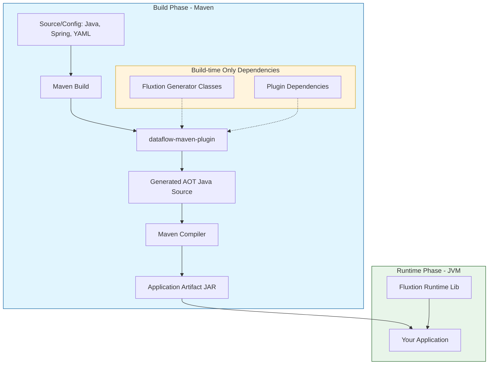

# dataflow-maven-plugin
A Maven plugin integrating the Fluxtion toolset with the Maven build cycle.

## Overview
Fluxtion is a high-performance, low-latency event processing engine. The `dataflow-maven-plugin` automates the generation of Fluxtion event processors from various sources (scanned classes, Spring contexts, or YAML configurations) during the Maven build lifecycle.

## Architecture and Execution Path

The following diagram illustrates how the `dataflow-maven-plugin` fits into the developer's execution path, highlighting the separation between build-time generation and runtime execution.



### Key Concepts

*   **Build-time Generation**: The `dataflow-maven-plugin` executes during the Maven `compile` phase. It processes your input configurations and generates optimized **Ahead-of-Time (AOT)** Java source code.
*   **AOT Source Usage**: The generated AOT source is automatically included in the compilation process. Your application code can then directly reference and use these generated classes for high-performance event processing.
*   **Separation of Concerns**: Fluxtion generator classes and plugin-specific dependencies are **only required during the build**. They do not need to be present on the runtime classpath, keeping your application artifact lean and minimizing runtime dependency conflicts.
*   **Runtime Requirements**: At runtime, your application only needs the core Fluxtion runtime library to execute the AOT-generated event processors.

## Repository Configuration
The plugin's dependencies are also in the same repository, you will need:

```xml
<repositories>
    <repository>
        <id>repsy-fluxtion</id>
        <name>Fluxtion public maven repo on Repsy</name>
        <url>https://repo.repsy.io/mvn/fluxtion/fluxtion-public</url>
    </repository>
</repositories>
```

## Usage

The plugin goals are bound to the `compile` phase by default. To trigger execution, you must define an `<execution>` block for the desired goal.

### Common Configuration
| Parameter | Description | Default |
|-----------|-------------|---------|
| `outputDirectory` | Path for generated Java sources. | `${project.build.sourceDirectory}` |
| `resourcesDirectory`| Path for generated resources. | `src/main/resources` |
| `-DskipFluxtion` | Command-line property to skip Fluxtion generation. | `false` |

### Goals

#### 1. `scan`
Scans compiled project classes for Fluxtion builder definitions and generates event processors.

```xml
<plugin>
    <groupId>com.fluxtion.dataflow</groupId>
    <artifactId>dataflow-maven-plugin</artifactId>
    <version>1.2.1</version>
    <executions>
        <execution>
            <goals>
                <goal>scan</goal>
            </goals>
            <configuration>
                <buildDirectory>target/classes</buildDirectory>
            </configuration>
        </execution>
    </executions>
</plugin>
```
*   `buildDirectory`: Directory to scan for classes (default: `target/classes`).

#### 2. `springToFluxtion`
Generates a Fluxtion event processor from a Spring context definition.

```xml
<plugin>
    <groupId>com.fluxtion.dataflow</groupId>
    <artifactId>dataflow-maven-plugin</artifactId>
    <version>1.2.1</version>
    <executions>
        <execution>
            <goals>
                <goal>springToFluxtion</goal>
            </goals>
            <configuration>
                <className>com.example.GeneratedProcessor</className>
                <packageName>com.example</packageName>
                <springFile>src/main/resources/spring.xml</springFile>
            </configuration>
        </execution>
    </executions>
</plugin>
```
*   `className`: (Required) Fully qualified name of the class to generate.
*   `packageName`: (Required) Package for the generated class.
*   `springFile`: (Required) Path to the Spring XML configuration.

#### 3. `yamlToFluxtion`
Generates event processors from YAML configuration files.

```xml
<plugin>
    <groupId>com.fluxtion.dataflow</groupId>
    <artifactId>dataflow-maven-plugin</artifactId>
    <version>1.2.1</version>
    <executions>
        <execution>
            <goals>
                <goal>yamlToFluxtion</goal>
            </goals>
            <configuration>
                <fluxtionConfigFiles>
                    <file>src/main/resources/config.yaml</file>
                </fluxtionConfigFiles>
            </configuration>
        </execution>
    </executions>
</plugin>
```
*   `fluxtionConfigFiles`: (Required) Array of YAML configuration files to process.

## Signing in to the Fluxtion compiler

The generation goals can use a Fluxtion compiler account instead of a RapidAPI key. The compiler's address is
not a secret, so it can go in the POM (`<compilerUrl>` in the plugin configuration), on the command line
(`-Dfluxtion.compilerUrl=...`) or in the `FLUXTION_COMPILER_URL` environment variable. The examples use the
placeholder `https://compiler.example.com`.

**A credential is never accepted from a POM.** If a `<token>`, `<apiToken>` or `<credential>` parameter, or a
credential property such as `fluxtion.remote.token` or `FLUXTION_API_TOKEN`, appears in the POM or one of its
profiles, the build fails and says to use the environment variable or `fluxtion:login` instead.

### Developer machine: `mvn fluxtion:login`

```bash
mvn fluxtion:login -Dfluxtion.compilerUrl=https://compiler.example.com
```

The goal prints a short code and a verification address. Open the address, enter the code and approve. If a
desktop is available, pressing Enter opens the page in your browser; it never opens one by itself. When you
approve, the plugin stores the credential in `~/.fluxtion/credentials` and prints your account, your plan, the
compile credits and interpret credits you have left, and the plan's limits (for example
`Plan: Free; compile credits available: 250; interpret credits available: 40.` and
`Plan limits: 20 nodes, 6 inputs (event types + exported methods), 1 exported interface, targets Java.`). Inputs
are the graph's event types plus the methods of the interfaces it exports, each method counting as one input. A
compiler from before plans reports only the compile credits, and the plugin prints only those; one from before the
inputs limit reports its event-type limit, which is printed as the inputs limit. The code expires after the time shown, and declining in the browser ends
the attempt.

A build the compiler refuses fails with the compiler's reason as the failure message. For a graph beyond your plan
that is, for example, `The Fluxtion compiler refused this build. Your plan does not allow this graph: ... (maxNodes:
120 > 20 (free)); a higher plan allows more [HTTP 403, request ...]`; the limit named may also be `maxInputs` (for
example `maxInputs: 7 > 6 (free)`) or `maxExportedInterfaces`. Nothing is charged for a refused build. To move
to a higher plan, contact Telamin; there is no online purchase.

On macOS and Linux the file is created owner-only (`rw-------`, in an `rwx------` directory) before anything is
written to it. Windows has no POSIX permissions, so the plugin replaces the file's access list with a single entry for you
before anything is written to it. The plugin never writes the credential anywhere else, including
`target/`, generated sources or reports, and never prints it.

`mvn fluxtion:login` works inside a project that declares this plugin. Anywhere else, use the full coordinates
(`mvn com.telamin.fluxtion:fluxtion-maven-plugin:<version>:login`) or add `com.telamin.fluxtion` to
`<pluginGroups>` in `~/.m2/settings.xml`.

### CI: `FLUXTION_API_TOKEN`

CI never signs in interactively, and `fluxtion:login` refuses to run when the `CI` environment variable (or a
CI system's own marker, such as `JENKINS_URL` or `TF_BUILD`) is set.
An account administrator creates an automation credential in the account's credentials list, and you store it as
a secret that the build sees as `FLUXTION_API_TOKEN`:

```yaml
# GitHub Actions
env:
  FLUXTION_API_TOKEN: ${{ secrets.FLUXTION_API_TOKEN }}
  FLUXTION_COMPILER_URL: https://compiler.example.com
```

### Which credential is used

1. `FLUXTION_API_TOKEN`, if it is set. A compiler URL (`FLUXTION_COMPILER_URL` or `<compilerUrl>`) is then
   required: the build fails rather than send the credential to the builder's default host.
2. Otherwise, the credential stored by `fluxtion:login`, sent only to the compiler that issued it. If
   `compilerUrl` names a different compiler, the build fails and says to sign in to that one.
3. Otherwise, nothing changes: the builder uses your RapidAPI key as before.

With a credential, the plugin runs the builder in token mode (the system properties `fluxtion.remote.auth=token`
and `fluxtion.remote.token`, plus `fluxtion.remote.host` and `fluxtion.remote.port` from the compiler URL) only
while the builder runs, and restores the earlier values afterwards. In a parallel build (`mvn -T`) generation
goals that use a credential take turns, because those properties are shared by the whole JVM.

Committed configuration is checked as well as the POM: a credential property in a parent POM or in
`.mvn/maven.config` / `.mvn/jvm.config` also fails the build.

### Signing out: `mvn fluxtion:logout`

```bash
mvn fluxtion:logout
```

This revokes the stored credential on the service that issued it and deletes `~/.fluxtion/credentials`. If the service cannot be
reached, the file is still deleted and the plugin says so; revoke the credential from the account's credentials
list. Logout does not affect a `FLUXTION_API_TOKEN` set in your environment.

## Skipping Execution
To temporarily disable the plugin during a build, use the `skipFluxtion` system property:

```bash
mvn compile -DskipFluxtion
```


